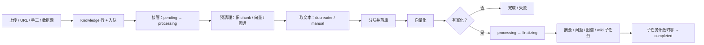

# 入库链路（一页纸）

> 回答三个问题：一份文档从哪进来、经过哪些阶段、卡住时看哪里。
> 问答链路见 [`qa-flow.md`](qa-flow.md)；检索阶段见 [`rag-pipeline.md`](rag-pipeline.md)。

## 一分钟版

一句话：**入口只落一行 `Knowledge` 并入队；`KnowledgeProcessWorker` 负责“接管 → 预清理 → 取文本 → 分块 → 向量化 → 晋升 finalizing”；富化子任务完成后由计数收口。**

## 入口

| 入口 | 代码 | 说明 |
|---|---|---|
| 文件上传 | `POST /api/v1/knowledge-bases/{id}/knowledge/file` | 先落文件与 `Knowledge` 行 |
| URL | `POST /api/v1/knowledge-bases/{id}/knowledge/url` | 抓取后同样落 `Knowledge` 行 |
| 手工 | `POST /api/v1/knowledge-bases/{id}/knowledge/manual` | 正文在 `metadata.content` |
| 数据源 | `DataSourceService` / `DataSourceSyncHandler` | 只负责“取回并转成仓内文档”，入库仍归本链路 |

入口最终都调用 {@link com.ragagent.knowledge.task.KnowledgeProcessWorker#enqueue(String)}。
入队时捕获 `traceparent` 与租户 ID：worker 线程查不到自建模型，租户必须随任务带过去。

## 主阶段

1. **接管**：`CAS pending → processing`。被抢、已取消或已删除时静默退出，不报错。
2. **预清理**：回收上次抽取的图片、删旧 chunk、清旧向量、删旧图谱（图谱失败只告警）。
3. **取文本**：
   - `manual` 直接读 `Knowledge.metadata.content`；
   - 文件走 `docreader` 解析，图片引用经 `ExtractedImageStore` 落盘并重写 URL。
4. **分块**：`chunker` 产出 `Chunk`，落 `ChunkRepository`；本次尝试的 chunk id 要记下来，失败只清本次产物。
5. **向量化**：按 KB 的索引策略解析 embedding 模型；绑定了引擎的走引擎口，未绑定走 pg 向量表。
6. **晋升 finalizing**：计算富化计划：
   - wiki：KB 开启 wiki 且能解析出合成模型；
   - 图谱：KB 开启 graph；
   - 问题生成：开启且有 embedding 能力；
   - 摘要：有摘要模型时单独 fan-out，不占 finalizing 计数。
   - `pending_subtasks_count = wiki 1 + 问题批数 + 图分块数`，`CAS processing → finalizing`。
7. **子任务收口**：每个子任务完成/失败都减计数；归零后 `completed`（失败按状态机终止）。取消/删除会抢走行，晋升失败时不再覆盖状态。

## 阶段类

| 阶段 | 类 |
|---|---|
| 取文本 | {@link com.ragagent.knowledge.task.KnowledgeTextExtractor} |
| 分块落库 | {@link com.ragagent.knowledge.task.KnowledgeChunkWriter} |
| 预清理 / 向量化 / 清场 | {@link com.ragagent.knowledge.task.KnowledgeIndexStage} |
| 富化计划 / 晋升 / fan-out / 收口 | {@link com.ragagent.knowledge.task.KnowledgeFinalizingStage} |

{@link com.ragagent.knowledge.task.KnowledgeProcessWorker} 只保留接管、租户作用域、阶段排序与异常转发。

## 状态机

| 状态 | 含义 | 谁推进 |
|---|---|---|
| `pending` | 已落行、等待 worker | `KnowledgeProcessWorker.enqueue` |
| `processing` | 解析 / 分块 / 向量化中 | worker 主阶段 |
| `finalizing` | 富化子任务进行中 | wiki / 问题 / 图谱子任务 |
| `completed` | 全部完成 | 子任务计数归零 |
| `failed` | 失败终止 | `failOrComplete` |
| `aborted` | 用户取消/删除 | 取消端点或删除 |

## 想改 X 去哪

| 需求 | 落点 | 不要 |
|---|---|---|
| 新增一种文本来源 | `extractMarkdown` 或入口 controller/service | 往 `processInner` 里塞分支 |
| 新增一种分块策略 | `chunker` + `Chunker` 实现 | 改 worker 主流程 |
| 新增一种向量后端 | `retrieval-engine` + `VectorIndexStore` 契约 | 在 worker 里直连厂商 |
| 新增一种富化子任务 | `planFinalizing` 增加计划项 + 子任务队列 + 计数 | 绕过 `pending_subtasks_count` 直接改状态 |
| 新增一个管理页进度 | `KnowledgeProcessingSpan` / `KnowledgeController` 查询面 | 新增一套并行状态字段 |
| 调整失败重试 | `failOrComplete` + 队列 `RetryPolicy` | 在 controller 里重试 |

## 读代码顺序

1. {@link com.ragagent.knowledge.controller.KnowledgeController} — 入口与查询面
2. {@link com.ragagent.knowledge.task.KnowledgeProcessWorker} — 主状态机
3. {@link com.ragagent.knowledge.repository.KnowledgeRepository} /
   {@link com.ragagent.knowledge.repository.KnowledgeBaseRepository} /
   {@link com.ragagent.knowledge.repository.ChunkRepository} — 行与 chunk 的读写
4. {@link com.ragagent.embedding.EmbeddingVectors} — 向量化响应校验（客户端由 ModelRuntime 按模型 id 装配）
5. {@link com.ragagent.knowledge.task.ChunkExtractTaskQueue} /
   {@link com.ragagent.knowledge.task.QuestionGenerationTaskQueue} — 异步子任务
6. {@link com.ragagent.wiki.service.ingest.WikiIngestService} — wiki 交接

## 已知边界

- **数据源只负责取回**：连接器不解析、不分块、不建索引；进入知识库后的处理全在本链路。
- **wiki 是独立管线**：知识库只负责把文档交给 wiki ingest；页面/修订/链接图归 wiki 域。
- **摘要不计入 finalizing 槽**：它有自己的状态字段；不要把摘要当成第 4 种 finalizing 子任务。
- **取消是 CAS 抢行**：不是发信号中断；长阶段只在检查点看 `aborted`。
