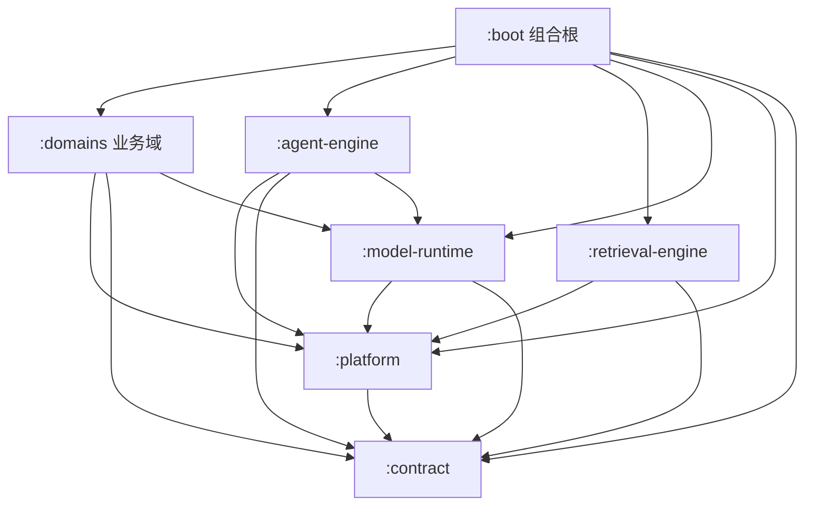

# 架构总览

七个 Maven 模块，依赖单向、边界在编译期强制。读代码前先记住一句话：**业务在 `:domains`，能力在三个 runtime，技术底座在 `:platform`，形状在 `:contract`，装配在 `:boot`。**

## 模块与依赖

| 模块 | 职责 | 依赖 | 源码根 |
|---|---|---|---|
| `:contract` | 公开 API、SPI、不可变载荷；**纯 JDK，零生产依赖** | 无 | `com.ragagent.contract.*`（24 个子包） |
| `:platform` | Web 外壳、错误形态、SSRF、事件总线、SSE 流、追踪、提示词与配置装载 | contract | `com.ragagent.platform.*`（19 个子包） |
| `:model-runtime` | 26 家 LLM provider、Embedding / Rerank 客户端、模型上下文装配、抽取、Ollama | platform · contract | `com.ragagent.{embedding,llm,modelcontext,modelruntime,rerank}` |
| `:retrieval-engine` | 九种向量/检索后端、混合检索融合、重排管线、索引写入 | platform · contract | `com.ragagent.retrieval.*` |
| `:agent-engine` | ReAct 循环、工具注册表、技能、上下文压缩、预算与转向 | platform · contract · model-runtime | `com.ragagent.agent.*` |
| `:domains` | 19 个业务域；51 个 HTTP 控制器；持久层 | platform · contract · model-runtime | `com.ragagent.<domain>.*` |
| `:boot` | 应用入口、全局装配、跨模块 Bean、扫描与打包；只出不进 | 全部 | `com.ragagent` + `com.ragagent.config` |

三条设计原则：

1. **契约纯 JDK**：跨模块公开类型只在 `:contract`，不出现框架依赖；由 `scripts/check-contract-purity.py` 硬零守卫。
2. **端口下沉，实现在下**：业务域通过 contract 端口消费能力，实现由 `:boot` 装配；例外是 `agent-engine`——它的 Bean 由根包组件扫描发现（`boot` 对其主码 0 引用），见下方「装配点」的已知机制。
3. **服务端分层**：Controller 只编排 → Service 承载用例 → Repository/Mapper 封装持久化；每个包有 `package-info.java`。

## 代码在哪

| 想改什么 | 先去 |
|---|---|
| HTTP 路由 / 参数绑定 | `domains/src/main/java/com/ragagent/<域>/controller/` |
| 业务用例 / 事务边界 | `<域>/service/` |
| SQL / 软删 / 方言 | `<域>/repository/` 或 `<域>/mapper/` |
| 检索融合、重排、引擎注册 | `retrieval-engine/src/main/java/com/ragagent/retrieval/` |
| LLM provider / embedding / rerank 客户端 | `model-runtime/src/main/java/com/ragagent/{llm,embedding,rerank}/` |
| Agent 循环 / 工具 / 技能 / 压缩 | `agent-engine/src/main/java/com/ragagent/agent/` |
| 管线阶段与插件 | `domains/.../session/rag/`，装配在 `session/assembly/QaWiring` |
| 跨模块 Bean / 端口实现 | `boot/src/main/java/com/ragagent/config/`；域内装配点见下方「装配点」 |
| 跨模块公开类型 | `contract/src/main/java/com/ragagent/contract/` |
| 域对外的端口实现 | `<域>/api/`：实现 `contract` 端口（Adapter），供其他域或装配层依赖；不要反向依赖 controller |

## 协作者命名（M7 判据）

| 后缀 | 判据 | 形态 |
|---|---|---|
| `*Service` | 有状态、依赖协作的用例编排；可能开事务 | Spring bean |
| `*Ops` | 同一门面的运行面/通道面切片，必须由门面构造并共享其状态 | 包级类，不单独成 bean（避免循环依赖） |
| `*Support` | 无状态或轻量协作器，不持有运行时状态、不依赖 Spring 代理 | 包级类/静态方法 |
| `*Adapter` | 实现 `contract` 端口，放在 `<域>/api/` | Spring bean |
| `*Resolver` / `*Locator` / `*Codec` / `*Projector` | 单一职责的技术协作者（解析/查找/编解码/投影） | 包级类，不起门面 |

不新增 `Default*Service`、`*Manager`、`*Helper` 这类无判据命名；已有类不强制改名（改名单独评估调用面）。

## 响应信封（待会签）

新接口统一用 `platform.web.ApiResponse`；`DataSourceController` / `EmbedChannelController` 的 `{"error": ...}` 是既有线格式，前端与金片依赖，**不夹在代码质量批里统一**，待产品/前端会签后单独立项（M8）。

## 装配点（`@Configuration`）

全仓 22 个装配类，由 `scripts/check-wiring-points.py` 守卫：新增/删除必须同时改本表与 `scripts/wiring-points.baseline.json`。分类判据是**装配的东西属于谁**。

**组合根（`:boot/config`，8 个）**——跨模块 Bean 的唯一集中地：

| 装配点 | 负责什么 |
|---|---|
| `EnvLookupWiring` | 向量库 env 族查找面（`System::getenv` → Spring `Environment`，测试可覆盖） |
| `ImAdapterWiringConfig` | 9 个 IM 渠道适配器工厂逐行注册进编排器 |
| `ModelConcurrencyGovernorWiring` | 模型并发闸门（limit 取 DB → env → 缺省，后端可选进程内/共享实现） |
| `ModelRuntimeBeansWiring` | 模型运行时的两个进程级 bean |
| `MybatisPlusConfig` | 持久层插件链：分页 + 全表写防护 + 租户过滤探测 + 软删过滤探测 |
| `RetrievalEngineWiringConfig` | 检索引擎注册表与环境店注册（`RETRIEVE_DRIVER` 按段注册） |
| `RuntimeSnapshotWiring` | 启动期只读快照（语言默认值、上传限额、AES 密钥、SSRF 白名单等） |
| `WebConfig` | Web 壳：Jackson / CORS / 请求 ID 过滤器与拦截器链（API Key 闸门、信封、RBAC、追踪） |

**域内装配（`domains`，10 个）**——装配的是本域实现或本域数据，因此留在域内；上移会把域内类型拉进组合根：

| 装配点 | 负责什么 |
|---|---|
| `DataSourceWiring` | 数据源连接器注册（`ConnectorRegistry`），连接器实现全在本域 |
| `DataSourceTaskQueueWiring` | 本域任务队列的 Memory/Redis 实现选择 |
| `EmbedWiring` | 嵌入渠道运行时装配（消费会话域端口） |
| `KnowledgeRedisWiring` | 知识域进度/索引队列与锁的 Redis 实现选择 |
| `McpWiring` | MCP 服务与工具发现装配（客户端与协议实现在本域） |
| `McpOAuthWiring` | MCP OAuth 授权链装配 |
| `MemoryTaskQueueWiring` | 记忆抽取队列的实现选择 |
| `QaWiring` | chat 管线装配：17 个插件类与管线端口适配器都是本域内部类型 |
| `StorageUrlWiringConfig` | 存储 URL 签名策略（策略与 provider 面都在本域） |
| `WikiRedisWiring` | wiki 队列与分布式锁的 Redis 实现选择 |

**能力模块内装配（`platform` / `retrieval-engine`，4 个）**——模块自己的基建装配：

| 装配点 | 负责什么 |
|---|---|
| `LlmTransportWiring` | 把可运行时调谐的 `SsrfGuard` 单例交给 LLM 传输层 |
| `StreamManagerConfig` | SSE 流管理器 Memory/Redis 选择；选 Redis 时启动即 Ping |
| `LangfuseWiring` | 追踪装饰器装配（未配置即 no-op，配置无效拒启） |
| `Neo4jGraphConfig` | 图仓储装配（`NEO4J_ENABLE` 门控，未启用退化为 no-op） |

**已知机制**：`agent-engine` 的 Bean 不在上表——`:boot` 对它主码 0 引用，其 Bean 由 `@SpringBootApplication` 的根包组件扫描（`com.ragagent`）发现。编译图看不见运行图，这是端口化的代价，按已知机制登记而非待修缺陷。

## 19 个业务域

控制器数量只是"有没有 HTTP 面"的指标，不代表复杂度：

| 域 | 控制器 | 说明 |
|---|---|---|
| `session` | 8 | 会话、消息、问答、SSE 续流、附件 |
| `knowledge` | 8 | 知识库、文档、分块、标签、FAQ、索引 |
| `auth` | 6 | 登录、注册、OIDC、API Key、成员 |
| `mcp` | 4 | MCP 服务、工具发现、OAuth、工具审批 |
| `model` | 4 | 模型配置、Ollama 本地模型管理 |
| `websearch` / `storage` | 各 3 | 搜索提供商、存储后端 |
| `agentmanagement` / `system` / `im` / `datasource` | 各 2 | Agent 管理、系统信息与指标、IM 渠道、数据源 |
| `wiki` / `vectorstore` / `memory` / `initialization` / `favorite` / `embedchannel` / `audit` | 各 1 | 各自单面 |
| `agenttools` | 0 | 无独立 HTTP 面（内部工具能力） |

合计 51 个控制器。域的完整清单：`agentmanagement`、`agenttools`、`audit`、`auth`、`datasource`、`embedchannel`、`favorite`、`im`、`initialization`、`knowledge`、`mcp`、`memory`、`model`、`session`、`storage`、`system`、`vectorstore`、`websearch`、`wiki`。

## 模块名与包名不完全对应（刻意）

- `model-runtime` 有 5 个源码根：`embedding` / `llm` / `modelcontext` / `modelruntime` / `rerank`，只有 1 个与模块同名。拆模块时按能力族分，不按模块名分。
- `boot` 主代码只有入口 + `config/`，但测试树有 23 个业务包（另根包 1 个测试类）：集成测试必须从 HTTP 面进，只能住在组合根。
- 全仓仍有 9 个跨模块错位测试（domains 测试树 8：platform 5、model-runtime 3；platform 测试树 1：contract 规则测试）：它们依赖 domains 载荷，迁走会形成 `test → domains` 反向边。已逐个登记在 `scripts/check-module-graph.py` 的 `MISPLACED_TEST_ALLOW`（带理由，只许减）；新增错位即红。
- 这**不是**待修的错位；改包名会产生 1600+ 文件的 diff，换不来行为收益。判据与理由见 `docs/internal/HANDOFF.md` 的模块/包映射说明。
- 测试夹具包已从 `com.ragagent.common` / `com.ragagent.support` 改为 `com.ragagent.fixtures`；守卫会拦这两个已解散包回流。

按模块名找代码失败时，先看 [`domain-index.md`](domain-index.md)（19 个业务域按 5 类能力组织：种类、入口、契约面、前端页面，由 `scripts/gen-domain-index.py` 生成），再看 [`module-package-map.md`](module-package-map.md)（7 个模块的包根 + 19 个业务域的包/控制器数量，由 `scripts/gen-module-map.py` 生成），最后看 [`packages.md`](packages.md)（由 `scripts/gen-arch-index.py` 从 356 份 `package-info.java` 生成）。

## 构建约定

- 根 `pom.xml` 集中三件事：版本属性（单一来源）、Boot BOM（`<dependencyManagement>`）、插件版本与公共配置（compiler / surefire / javadoc / spotless）。
- 模块 `pom.xml` 只声明**依赖与模块专属插件**（proto、test-jar、failsafe 等），不要再复制版本、BOM、测试样板。
- 基础镜像 `maven:3.9-eclipse-temurin-21`；本机需自备 JDK 21 并设置 `JAVA_HOME`（Maven 不像 Gradle toolchain 那样自动下载 JDK）。

## 推荐阅读顺序

1. `contract`：先看 `AgentRunSpec`、`ToolResult`、`SearchResult`，知道跨模块传什么；
2. `platform`：看 `platform/access/TenantContext`、`platform/stream/StreamManager`、`platform/event/EventBus`；
3. `retrieval-engine`：看 `HybridSearchService` 与 `EngineRegistry`；
4. `agent-engine`：看 `AgentEngine` 的 `execute` 与 `ContextBudget`；
5. `domains/session`：看 `KnowledgeQaController` → `QaEntryRunner` → `QaTurnExecutor`；
6. `boot/config`：最后看装配，知道端口实现从哪来。

下一步读 [`request-path.md`](request-path.md)（一次问答怎么走）与 [`mechanisms.md`](mechanisms.md)（哪些地方反直觉）。
按业务链路找落点：`business-capability-map.md`（六条链路 → 入口/编排/落点）。
