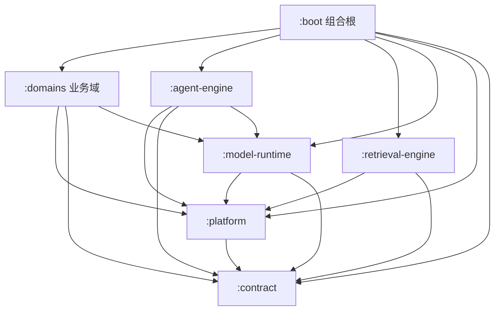

# 架构总览

七个 Gradle 模块，依赖单向、边界在编译期强制。读代码前先记住一句话：**业务在 `:domains`，能力在三个 runtime，技术底座在 `:platform`，形状在 `:contract`，装配在 `:boot`。**

## 模块与依赖

| 模块 | 职责 | 依赖 | 源码根 |
|---|---|---|---|
| `:contract` | 公开 API、SPI、不可变载荷；**纯 JDK，零生产依赖** | 无 | `com.ragagent.contract.*`（23 个子包） |
| `:platform` | Web 外壳、错误形态、SSRF、事件总线、SSE 流、追踪、提示词与配置装载 | contract | `com.ragagent.platform.*`（19 个子包） |
| `:model-runtime` | 27 家 LLM provider、Embedding / Rerank 客户端、模型上下文装配、抽取、Ollama | platform · contract | `com.ragagent.{embedding,llm,modelcontext,modelruntime,rerank}` |
| `:retrieval-engine` | 九种向量/检索后端、混合检索融合、重排管线、索引写入 | platform · contract | `com.ragagent.retrieval.*` |
| `:agent-engine` | ReAct 循环、工具注册表、技能、上下文压缩、预算与转向 | platform · contract · model-runtime | `com.ragagent.agent.*` |
| `:domains` | 22 个业务域；51 个 HTTP 控制器；持久层 | platform · contract · model-runtime | `com.ragagent.<domain>.*` |
| `:boot` | 应用入口、全局装配、跨模块 Bean、扫描与打包；只出不进 | 全部 | `com.ragagent` + `com.ragagent.config` |

三条设计原则：

1. **契约纯 JDK**：跨模块公开类型只在 `:contract`，不出现框架依赖；由 `scripts/check-contract-purity.py` 硬零守卫。
2. **端口下沉，实现在下**：业务域通过 contract 端口消费能力，实现由 `:boot` 注入。
3. **服务端分层**：Controller 只编排 → Service 承载用例 → Repository/Mapper 封装持久化；每个包有 `package-info.java`。

## 代码在哪

| 想改什么 | 先去 |
|---|---|
| HTTP 路由 / 参数绑定 | `domains/src/main/java/com/ragagent/<域>/controller/` |
| 业务用例 / 事务边界 | `<域>/service/` |
| SQL / 软删 / 方言 | `<域>/repository/` 或 `<域>/mapper/` |
| 检索融合、重排、引擎注册 | `retrieval-engine/src/main/java/com/ragagent/retrieval/` |
| LLM provider / embedding / rerank 客户端 | `model-runtime/src/main/java/com/ragagent/{llm,embedding,rerank}/` |
| Agent 循环 / 工具 / 技能 / 压缩 | `agent-engine/src/main/java/com/ragagent/agent/` |
| 管线阶段与插件 | `domains/.../session/service/rag/`，装配在 `QaWiring` |
| 跨模块 Bean / 端口实现 | `boot/src/main/java/com/ragagent/config/` |
| 跨模块公开类型 | `contract/src/main/java/com/ragagent/contract/` |

## 22 个业务域

控制器数量只是"有没有 HTTP 面"的指标，不代表复杂度：

| 域 | 控制器 | 说明 |
|---|---|---|
| `session` | 8 | 会话、消息、问答、SSE 续流、附件 |
| `knowledge` | 8 | 知识库、文档、分块、标签、FAQ、索引 |
| `auth` | 6 | 登录、注册、OIDC、API Key、成员 |
| `mcp` | 4 | MCP 服务、工具发现、OAuth |
| `model` / `websearch` / `agentmanagement` | 各 3 | 模型配置、搜索提供商、Agent 管理 |
| `system` / `storage` / `im` / `datasource` | 各 2 | 系统信息、存储后端、IM 渠道、数据源 |
| `wiki` / `vectorstore` / `memory` / `initialization` / `favorite` / `evaluation` / `embedchannel` / `audit` | 各 1 | 各自单面 |
| `approval` / `tenant` / `agenttools` | 0 | 无独立 HTTP 面（工具或内部能力） |

合计 51 个控制器。域的完整清单：`agentmanagement`、`agenttools`、`approval`、`audit`、`auth`、`datasource`、`embedchannel`、`evaluation`、`favorite`、`im`、`initialization`、`knowledge`、`mcp`、`memory`、`model`、`session`、`storage`、`system`、`tenant`、`vectorstore`、`websearch`、`wiki`。

## 模块名与包名不完全对应（刻意）

- `model-runtime` 有 5 个源码根：`embedding` / `llm` / `modelcontext` / `modelruntime` / `rerank`，只有 1 个与模块同名。拆模块时按能力族分，不按模块名分。
- `boot` 主代码只有入口 + `config/`，但测试树有 23 个业务包：集成测试必须从 HTTP 面进，只能住在组合根。
- `domains` 测试树仍有 10 个跨模块测试（platform 5、model-runtime 4、contract 1）：它们依赖 domains 载荷，迁走会形成 `test → domains` 反向边。已逐个登记在 `scripts/check-module-graph.py` 的 `MISPLACED_TEST_ALLOW`（带理由，只许减）；新增错位即红。
- 这**不是**待修的错位；改包名会产生 1600+ 文件的 diff，换不来行为收益。判据与理由见 `docs/internal/HANDOFF.md` 的模块/包映射说明。
- 测试夹具包已从 `com.ragagent.common` / `com.ragagent.support` 改为 `com.ragagent.fixtures`；守卫会拦这两个已解散包回流。

按模块名找代码失败时，先看 [`domain-index.md`](domain-index.md)（22 个业务域按 6 类能力组织：种类、入口、契约面、前端页面，由 `scripts/gen-domain-index.py` 生成），再看 [`module-package-map.md`](module-package-map.md)（7 个模块的包根 + 22 个业务域的包/控制器数量，由 `scripts/gen-module-map.py` 生成），最后看 [`packages.md`](packages.md)（由 `scripts/gen-arch-index.py` 从 337 份 `package-info.java` 生成）。

## 构建约定

- `build-logic/` 提供两套 convention：
  - `ragagent.java-conventions`：JDK 21 toolchain、Spotless（ratchet + import 口径）、Boot BOM；
  - `ragagent.test-conventions`：JUnit Platform、Mockito `byte-buddy-agent`（惰性挂载）、默认 1g 测试堆。
- 模块 `build.gradle.kts` 只声明**依赖与模块专属任务**（proto、migrations、`integrationTest`、`bootRun` 等），不要再复制 toolchain/Spotless/BOM/测试样板。
- Gradle wrapper `8.14.3`；本机缺 JDK 21 时由 foojay resolver 自动下载。

## 推荐阅读顺序

1. `contract`：先看 `AgentRunSpec`、`ToolResult`、`SearchResult`，知道跨模块传什么；
2. `platform`：看 `platform/access/TenantContext`、`platform/stream/StreamManager`、`platform/event/EventBus`；
3. `retrieval-engine`：看 `HybridSearchService` 与 `EngineRegistry`；
4. `agent-engine`：看 `AgentEngine` 的 `execute` 与 `ContextBudget`；
5. `domains/session`：看 `KnowledgeQaController` → `QaEntryRunner` → `QaTurnExecutor`；
6. `boot/config`：最后看装配，知道端口实现从哪来。

下一步读 [`request-path.md`](request-path.md)（一次问答怎么走）与 [`mechanisms.md`](mechanisms.md)（哪些地方反直觉）。
