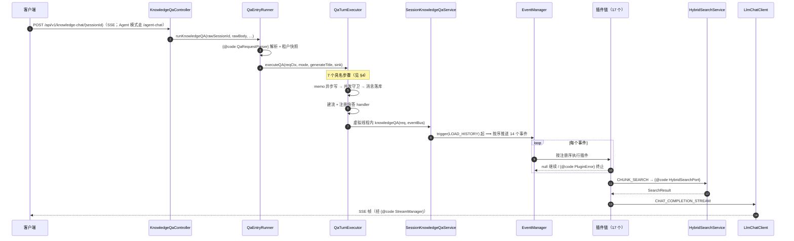

# 问答主链路（QA Flow）

> 目标：新人 20 分钟能说清「一次提问从 HTTP 到 LLM 经过哪些步骤、改一个需求动哪里」。
> 文中 `{@code 类名}` 由 `scripts/check-qa-flow.py` 校验真实存在（防过期）。

## 1. 端到端时序



## 2. 入口判定（4 个入口，1 个状态机）

| 入口 | 触发方式 | 与主入口的差异 |
|---|---|---|
| `{@code KnowledgeQaController}` | HTTP SSE | 主入口，带 sink |
| `{@code SessionQaAdapter}` | 域内调用（`SessionQaPort`） | 无 HTTP，直接注入 |
| `{@code KnowledgeQaEventAdapter}` | 事件驱动 | 无 HTTP |
| `{@code QaTurnExecutor}` 的 follow-up | steer 后续轮 | 带 `asyncDone` 完成信号 |

四者最终都进入 `{@code QaTurnExecutor}` → `{@code SessionKnowledgeQaService}`。

## 3. 事件顺序（14 个）

```
LOAD_HISTORY → MEMORY_RECALL → QUERY_UNDERSTAND → CHUNK_SEARCH
  → CHUNK_SEARCH_PARALLEL → ENTITY_SEARCH → CHUNK_RERANK → WEB_FETCH
  → CHUNK_MERGE → DATA_ANALYSIS → INTO_CHAT_MESSAGE → CHAT_COMPLETION
  → CHAT_COMPLETION_STREAM → FILTER_TOP_K
```

每个事件**有哪些插件、读写了哪些字段**：见 [pipeline-map.md](pipeline-map.md)（脚本生成）。

## 4. `executeQA` 的 7 个步骤

| 步骤 | 方法 | 关键约束 |
|---|---|---|
| 1 | `persistLastRequestStateAsync` | 派生线程无 ThreadLocal ⇒ 必须 capture/replay |
| 2 | 并发守卫（AGENT 模式） | 另一轮在跑则 409 |
| 3 | `persistTurnOrFail` | 落库失败走 HTTP 500（流尚未建立） |
| 4 | `carryOverSteerEvents` | 必须在公布 live 之前接上 |
| 5 | `setupSseOrRollback` | 失败先回滚消息，再抛 409/503 |
| 6 | `registerQuickAnswerHandlers` | 快答路径：thought 累积 + 完成事件 |
| 7 | `startAsyncRunner` | 租户快照、引擎调用、错误事件、收尾 |

## 5. 改功能 → 动哪些文件

| 需求 | 主要文件 |
|---|---|
| 改检索编排 | `PluginSearch`、`HybridSearchService` |
| 加检索后端 | `retrieval-engine/…/engine/`（实现 `IndexEngine` 并注册） |
| 改提示词 | `platform/prompt/` |
| 改模型接入 | `model-runtime/…/llm/provider/`（实现 `LlmChatClient`） |
| 改问答流程 | `QaTurnExecutor`（7 步）+ `SessionKnowledgeQaService` |
| 加一个管线步骤 | 新增 `Plugin` 实现 + 在 `QaWiring` 注册 + 重跑 `gen-pipeline-map.py` |
| 改错误形态 | `GlobalExceptionHandler`（唯一出口，见 `docs/api-response-convention.md`） |
| 改路由权限 | `boot/config/RbacRoutePolicies` |

## 6. 三条不变量（都踩过坑）

1. **租户**：跨虚拟线程必须 `TenantContextSnapshot.capture()` + `TenantScope.run()`；直接 start 会读到租户 0。
2. **顺序**：memo 异步写 → 并发守卫 → 落库 → 建流 → 异步执行 → 推流；顺序不可换。
3. **失败**：插件返回 `PluginError` 即终止整条链（后续插件与事件都不再跑）。

## 7. 三个「去哪找」入口

| 想知道 | 看 |
|---|---|
| 接口的实现在哪个类 | [port-map.md](port-map.md)（40 个 Port 对照表） |
| 事件有哪些插件、读写什么 | [pipeline-map.md](pipeline-map.md) |
| 模块/包边界 | [module-package-map.md](module-package-map.md) |
