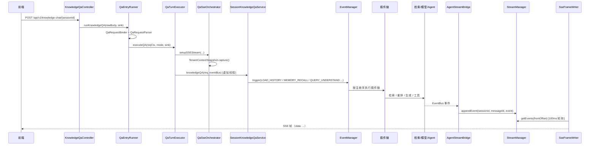

# 一次问答的调用链

入口有两个，共用同一套解析/执行簇：

- `POST /api/v1/knowledge-chat/{sessionId}` —— 普通知识库问答；
- `POST /api/v1/agent-chat/{sessionId}` —— Agent 模式（ReAct + 工具）。

## 主链路



量级：一条完整链路约 **22–25 个类、5–6 个模块、14 个包**；到第一个 SSE 帧就要跨约 18 个类。

这个数字本身不是缺陷：一次带鉴权、租户隔离、混合检索、流式生成与 SSE 的请求，跨 20+ 个类是常态。优化前的问题是**控制流不可见**——字符串事件键把"阶段"和"执行体"拆到两个文件、插件内部 `new` 插件、部分协作者是 Go struct/管线直译的副产物。优化方向是"把接缝类型化 + 补地图 + 消掉纯转发"，不是把类数压到个位数（O8 已把事件键换成 enum 并加了完整性测试）。

## 这是不是设计问题？

**是"可导航性"问题，不是"层数"问题。** 粗分这 25 个类：

| 类别 | 量级 | 判断 |
|---|---|---|
| 入口/编排（Controller → Runner → Parser → Executor → SSE/Finalizer） | 约 7 个 | 各自有生命周期职责，不建议合并；合并会造 god class |
| 管线（EventManager + Plugin 链 + ChatManage） | 约 4 个 | **主要债**：字符串键、隐藏注册、插件内部 new |
| 能力（HybridSearch / EngineRegistry / ModelRuntime / AgentEngine / ToolRegistry） | 约 5 个 | 必要分层，不动 |
| 输出（AgentStreamBridge / EventBus / StreamManager / SSE Writer） | 约 4 个 | 必要异步边界；100ms 轮询是刻意取舍 |
| 数据/端口（RequestContext / SseStreamContext / MessageService / TenantSnapshot） | 约 5 个 | 必要载体 |

哪些该优化、哪些不该：

| 动作 | 价值 | 风险 | 结论 |
|---|---|---|---|
| 管线阶段枚举化 + 完整性测试 | 高（编译期可查、IDE 可跳） | 低（行为不变） | 已做（O8） |
| 去掉插件内部的隐藏 `new`（显式注入/工厂） | 中（依赖可见） | 低 | 已做（O8；`PluginSearchParallel` 构造注入） |
| `TenantScope` 替代 30 处手工 capture | 高（防隐 bug） | 中 | 已做（O9） |
| `ChatManage` 40 个 setter 收成 5–6 个 apply 方法 | 中（可读性） | 低 | 做（O14） |
| 合并 QaEntryRunner / QaTurnExecutor / QaSseOrchestrator / QaTurnFinalizer | 低（只减类数） | 高（生命周期耦合、测试缝消失） | 不做 |
| 把 100ms 轮询改成推送 | 中（延迟） | 高（帧序/金片/多实例） | 先测量，不现在做 |
| 把链路压到 5–8 个类 | 负（god class） | 高 | 不做 |

判据：优化后应能"从阶段常量一次跳到执行体"、"新人在 2 分钟内找到 `chunk_rerank` 的三个插件"、"漏传租户身份在编译/测试期就红"——而不是"类数变少"。

## 五个最容易迷路的地方

### 1. `EventManager.trigger(PipelineEventType.CHUNK_SEARCH_PARALLEL, ...)` 的执行体在哪

`EventManager` 只存两类映射：`eventType → List<Plugin>` 与 `eventType → 闭包链`。触发点（`SessionKnowledgeQaService`）只看到枚举常量，插件注册在另一个文件 `QaWiring`（约 371-391 行）：

```
domains/.../session/service/QaWiring.java:371-391
```

`PluginSearchParallel` 的两个内部插件由 `QaWiring` 显式传入（构造注入）——它们**不注册**到 manager，只作为并行 fan-out 的内部执行体。这是刻意的（避免同一阶段出现第二个 handler），不要"顺手"把它们注册进去。

完整阶段表见 [`rag-pipeline.md`](rag-pipeline.md)。

### 2. 生成侧与输出侧不是同一个线程

`AgentStreamBridge` 订阅 16 种事件，按到达序把事件 append 进 `StreamManager`；HTTP 线程通过 `SessionStreamController` / `SseFrameWriter` **每 100ms 轮询** `getEvents(fromOffset)` 写 SSE。

后果：**代码顺序、日志顺序、帧顺序三者不重合**。排障时以 `messageId + event id` 为准，不要用日志时间戳推断帧顺序。

### 3. 身份不随虚拟线程走

`TenantContext` 是 ThreadLocal 语义。跨虚拟线程/异步任务时必须显式传快照；漏一次就是"owner 为空 / 静默 0 行"。原先全仓 30+ 处手工 `replay()`（15 个 `capture()` 站点），现已统一收口到 `TenantScope`（`run`/`supply`/`callable`），并由 `scripts/check-tenant-scope.py` 守卫禁止新的裸 `capture`/`replay`。这是全仓最容易被"优化"掉、也最容易埋隐 bug 的契约。

### 4. 一轮的收尾不在主链路里

`QaTurnFinalizer` 负责：assistant 消息落库、后续轮次交接、失败回滚、索引/建议/记忆的异步触发。主链路返回 ≠ 数据已经写完；排障"消息没落库"时先看 finalizer 的日志，而不是 controller。

### 5. 入口有三条，别只读 HTTP

`QaEntryRunner` 同时服务 HTTP 与 embed 面（`EmbedSessionAdapter`）；`SessionStreamController` 还提供 `continue-stream` 续流。三条入口共用同一执行簇，改一处要同时考虑另外两条。

## 日志关键字

| 关键字 | 含义 |
|---|---|
| `[capabilities]` | 起服能力摘要（检索 / JWT / 存储 / Redis / 流管理器） |
| `[PIPELINE] stage=...` | 管线阶段推进 |
| `[Agent]` | Agent 循环：开始、轮次、取消、工具 |
| `[Agent][Round-N]` | 某一轮的上下文/工具/裁剪 |
| `[QA]` | 轮次收尾与落库 |
| `[KnowledgeProcess]` / `[KnowledgePostProcess]` | 文档摄取与富化 fan-out |
| `[session-read-miss]` / `[session-read-forbidden]` | 会话可见性判定（排查"为什么 404"） |

## 排障清单

| 现象 | 先看 |
|---|---|
| 请求 404 / 401 | 路由与鉴权；`session-read-miss` / `session-read-forbidden` |
| 有回答但没有引用 | 起服 `retrieval=`、`engines=`；`chunk_search` 阶段日志 |
| 回答卡住不结束 | `AgentStreamBridge` 是否收到 `complete`；`StreamManager` 是否还有事件 |
| 中途断流 | `SseFrameWriter.write` 的 `IOException`（客户端断开检测靠写失败） |
| 消息没落库 | `QaTurnFinalizer` 的提交/回滚日志 |
| 工具调用失败 | `[Agent][Round-N]` + 工具名；MCP 服务是否可达 |

## 不要改的顺序契约

1. **错误帧在前、终态帧在后**：失败路径的 error 事件先发，`complete`/终态后补。
2. **`complete` 只能发一次**：`QaTurnFinalizer` 与执行循环共同保证，改并发逻辑时先读两边。
3. **SSE 头必须在任何帧之前写**：`SessionStreamController` 的参数校验先于 `setSSEHeaders`，否则错误会变成半个流。
4. **金片逐字节不变**：改帧形状/字段名要显式重录，不能"顺手格式化"。
